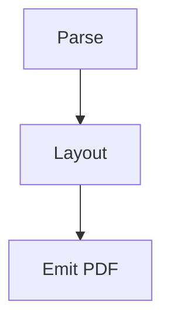

# Diagrams

sardown renders [Mermaid](https://mermaid.js.org) diagrams as real vector
graphics — not screenshots, and without launching a browser — using
[Ondine's compiler](https://github.com/wevm/ondine), with the pure-Rust
[merman](https://github.com/zed-industries/merman) renderer as the fallback.

## Writing a diagram

Use a ` ```mermaid ` fenced code block anywhere a normal code block would
go:

````markdown

````

sardown compiles this to an SVG internally and places it as a page element,
sized to fit within the content width.

## Supported diagram types

By default Ondine draws what it supports and merman draws the rest, so the
practical coverage is merman's: flowcharts and sequence diagrams are exercised
by sardown's own test suite and known to work; consult merman's documentation
for its full supported diagram set.

## When a diagram fails to compile

If a diagram's Mermaid source has a syntax error, sardown doesn't fail the
whole render: it prints a warning naming the file and the *exact* line and
column inside the diagram's own source (not just the location of the opening
` ``` ` fence), leaves that one diagram out of the output, and continues. For
example, a ` ```mermaid ` fence opened on line 3 of `notes.md`:

```
warning: failed to render the Mermaid diagram at notes.md:6:4: Diagram parse error (flowchart-v2): Unterminated node label (missing `]`)
```

points at the offending token on line 6, even though the fence opens three
lines earlier. A diagram Ondine rejects but merman can draw is not dropped:
the note says so and merman draws it.

## Diagrams inside books

When a diagram lives inside a chapter of a book rendered with
`render-book`, warnings name the chapter's own path (as listed in
`SUMMARY.md`), not an internal synthetic ID — so you can find the file to
fix directly from the warning.

## The `ondine` renderer (the default)

Ondine draws plain, monochrome diagrams set in a monospace font, colored from
your stylesheet rather than from Mermaid themes (`classDef`, `style` and
`%%{init}%%` colors are ignored). It is the default in any build with the
`ondine` feature — which `cargo install --path crates/sardown-cli` and
`./scripts/local-ci.sh` both have — and any diagram it does not support falls
back to merman, which reproduces Mermaid's own look:

```sh
cargo install --path crates/sardown-cli                    # the default: includes ondine
cargo install --path crates/sardown-cli --no-default-features --features png   # merman only
```

```toml
# The default in an `ondine` build; set this to draw everything with merman
# instead, and to get Mermaid's own themes, `classDef` and `%%{init}%%` colors.
renderer = "merman"
```

```toml
[mermaid]
border_color = "#609538"
node_fill = "#e3f2d7"
line_color = "#00689e"
```

- Text uses `[code_block.default].font_family` unless `[mermaid]` sets
  `font_family`; Ondine measures text as monospace, so a font whose glyphs
  advance 0.6 em (Red Hat Mono, DejaVu Sans Mono) fits its boxes exactly.
- A diagram type Ondine does not support is drawn by merman, with a note
  naming the line inside the diagram that Ondine rejected.
- Ondine is not on crates.io, so the feature builds it from a pinned git
  revision (network access needed to fetch it, and a crate built with the
  feature cannot be published to crates.io).
- Without the feature, diagrams are drawn by merman and the default
  `renderer = "ondine"` prints a warning.

## Text rendering inside diagrams

Diagram labels need a resolvable font to shape their text (the same
font-resolution rules as everywhere else — see
[Font Resolution](./troubleshooting.md#unknown-font-family-warnings)
apply). If no usable font is available at all, a diagram's boxes and
arrows (pure geometry) still render, but its text labels may be silently
dropped instead of appearing as visible text.
